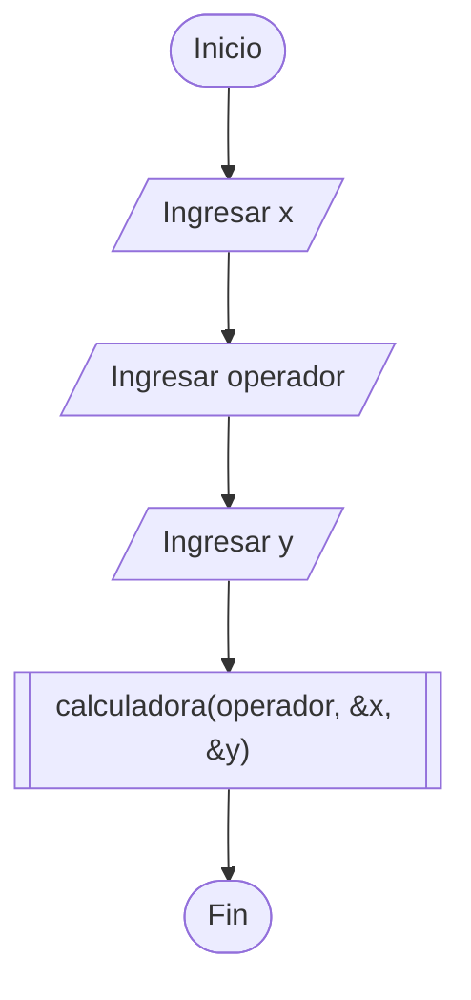
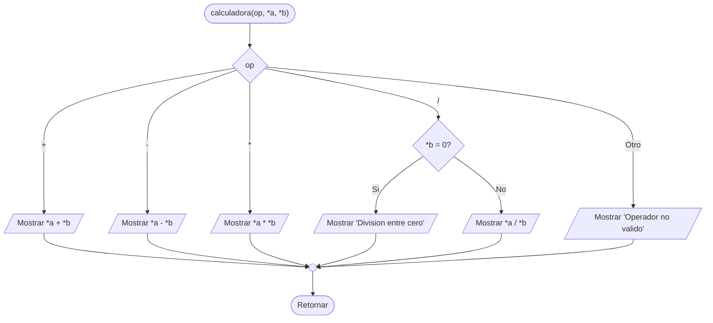
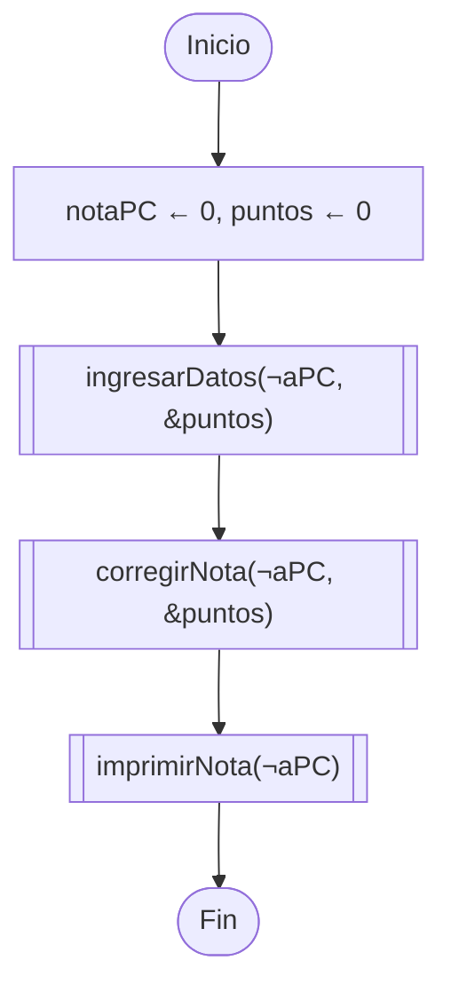
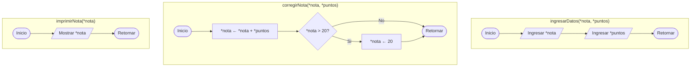

# CS6003 – Programación 2
## Unidad 3 · Punteros — Laboratorio 4A

Material de la sesión de laboratorio: código de ejemplo, ejercicios resueltos y diagramas de flujo.

---

## Contenido

| Archivo | Descripción |
|---|---|
| `coleccion2.cpp` | Actividad 1 – La Colección II (tamaños de tipos y punteros) |
| `jugando_con_punteros.cpp` | Actividad 2 – Los cinco programas de predicción |
| `ejercicio1_declaraciones.cpp` | Ejercicio 1 – Punteros a char, char** e int** |
| `calculadora_headers/` | Ejercicio 2 – Calculadora, separada en `.h` / `.cpp` / `main` |
| `ejercicio3_nota/` | Ejercicio 3 – Nota con bonificación, separada en tres archivos |

---

## Conceptos de la sesión

| Símbolo | En declaración | En expresión |
|---|---|---|
| `*` | `int* p;` → p es puntero a int | `*p` → el valor apuntado (desreferencia) |
| `&` | `int& r = a;` → r es una referencia | `&a` → la dirección de a (operador de dirección) |

**Regla práctica:** si el símbolo está pegado a un tipo, es parte del tipo (declaración). Si está suelto delante de una variable, es una operación.

**Tamaños:** `sizeof(tipo)` varía según el tipo (`char` 1, `int` 4, `double` 8), pero `sizeof(puntero)` es siempre 8 bytes en una arquitectura de 64 bits, porque un puntero guarda una dirección y todas las direcciones miden lo mismo.

---

## Compilación

Archivo único:

```bash
g++ -std=c++17 coleccion2.cpp -o coleccion2
./coleccion2
```

Proyectos con headers (hay que pasar **todos** los `.cpp`):

```bash
cd ejercicio3_nota
g++ -std=c++17 main.cpp nota.cpp -o nota
./nota
```

> Si compilas solo `main.cpp` obtendrás `undefined reference`: el header declara que la función existe, pero nadie proporcionó su implementación.

---

## Diagramas de flujo

### Ejercicio 2 – Calculadora (main)



Las variables `x` e `y` son `int` normales; con `&` se envían sus **direcciones**, porque la función declara los parámetros como `int*`.

### Ejercicio 2 – Subrutina `calculadora`



### Ejercicio 3 – Nota con bonificación (main)



El `main` solo reparte direcciones: toda la lógica vive en las subrutinas. `ingresarDatos` es el mejor argumento a favor de los punteros — tiene que devolver **dos** valores, y `return` solo permite uno.

### Ejercicio 3 – Las tres subrutinas



Solo `corregirNota` tiene una decisión; las otras dos son secuencias rectas. Separar en funciones no complica: hace que cada pieza haga una sola cosa.

---

## Notas para la sesión

**El caso del `char*`.** Al imprimir un puntero a `char`, `cout` no muestra la dirección: lo trata como cadena de texto e imprime bytes hasta encontrar un `\0`. Hay que forzar la conversión:

```cpp
char letra = 'A';
char* pLetra = &letra;

cout << pLetra;          // basura, o la letra por casualidad
cout << (void*)pLetra;   // la dirección
```

Si a alguien le sale solo la letra, no es que funcione: es que el byte siguiente valía cero por casualidad. Eso es **comportamiento indefinido** — código roto que a veces funciona.

**Variables sin inicializar.** `int a;` no vale cero: contiene los bytes que dejó lo que ocupó ese espacio antes. Inicializa siempre.

**Punteros dobles.** Cada `*` es un salto. `**ppa` significa "abre dos casillas": primero llegas al puntero, después al dato. En este curso no se usan más allá de la demostración conceptual.
